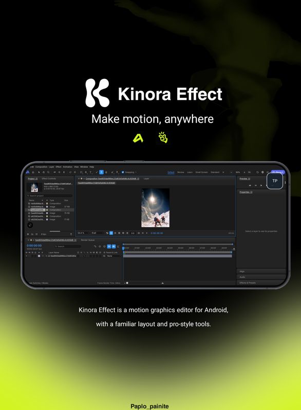

# Kinora Effect

  

**Kinora Effect** is an open-source motion graphics and visual effects editor for Android. It brings a desktop-style creative workspace to touch devices while keeping the panels, composition viewer, timeline, and familiar editing workflow together in one place.

The project is maintained by **Paplo-painite**, with assistance from **Manus AI**.

## Download

Download the latest public Android release from the official [GitHub Releases page](https://github.com/Paplo-painite/Kinora-Effect/releases/latest).

The current release is **v0.16.2**. It includes the current Kinora Effect artwork and the normal touch interface. Before installing an update, remove an older test build if Android reports a signature or installation conflict.

## Highlights

- Desktop-style workspace with docked panels and saved layouts.
- Composition viewer for previewing visual work.
- Timeline-based editing workflow.
- Project, layer, effect, property, audio, and render panels.
- UI Scale controls for small screens, from 50% to 200%.
- A **Fit** option and **Kinora Fit** workspace for making the desktop layout more comfortable on phones.
- Landscape workspace designed for touch-first Android use.
- Android file open/save support through the system file picker.
- Custom Kinora Effect launcher artwork and in-app branding.
- Built-in release update notification when a newer public version is available.

The repository artwork is available at [`assets/kinora-effect-repository-icon.png`](assets/kinora-effect-repository-icon.png). It is shown here as the project identity image and is separate from the editor's tool icons.

## Project preview

  

The preview image shows the Kinora Effect visual identity and desktop-style editing workspace on Android.

## Quick start

1. Install the APK from the latest release.
2. Open **Kinora Effect** and allow the application to finish loading its workspace.
3. Open or create a project from the application menu.
4. Use the **Composition** panel to view the result, the **Timeline** to arrange animated content, and the side panels to edit layers and properties.
5. Save regularly using the application’s save command.
6. Use the render/export controls when the project is ready.

For the complete walkthrough, read the [User Guide](docs/USER_GUIDE.md).

## Interface and touch tips

Kinora Effect uses a desktop-style layout. If controls look too small:

- Open **Settings > Appearance > UI Scale** and increase the scale.
- Use the **+** and **−** controls in the header for quick 10% adjustments.
- Use **Fit** to choose a screen-friendly scale and the **Kinora Fit** workspace.
- Rotate the device to landscape for the most comfortable workspace.
- Use a precise, short tap on small controls and drag directly on timeline handles or panel dividers.

The app uses the device’s normal touch input. The TP virtual mouse and its overlay controls are not part of this release.

## Project status

Kinora Effect is an active open-source project based on the EffectCraft creative application. It is still evolving, so some features may behave differently across Android devices. Please test important projects on a copy and report reproducible issues with device model, Android version, release version, and steps to reproduce.

- [Report a bug](https://github.com/Paplo-painite/Kinora-Effect/issues/new?template=bug_report.md)
- [Request a feature](https://github.com/Paplo-painite/Kinora-Effect/issues/new?template=feature_request.md)
- [View discussions and issues](https://github.com/Paplo-painite/Kinora-Effect/issues)

## Documentation

- [English User Guide](docs/USER_GUIDE.md)
- [Changelog](android-builder/CHANGELOG.md)
- [Third-party notices](THIRD_PARTY_NOTICES.md)
- [Contributing](CONTRIBUTING.md)
- [Security policy](SECURITY.md)

## Open-source and licensing

Kinora-specific source and documentation are available under the MIT License. The project includes upstream code and dependencies with their own licenses; see [THIRD_PARTY_NOTICES.md](THIRD_PARTY_NOTICES.md) and the accompanying license files. The Kinora launcher artwork is supplied by the repository owner and is not covered by the general MIT grant unless separately stated.

## Credits

- **Kinora Effect:** Paplo-painite
- **AI assistance:** Manus AI
- **Upstream creative application:** EffectCraft

If Kinora Effect helps your work, consider starring the repository and sharing a reproducible issue or improvement with the community.
