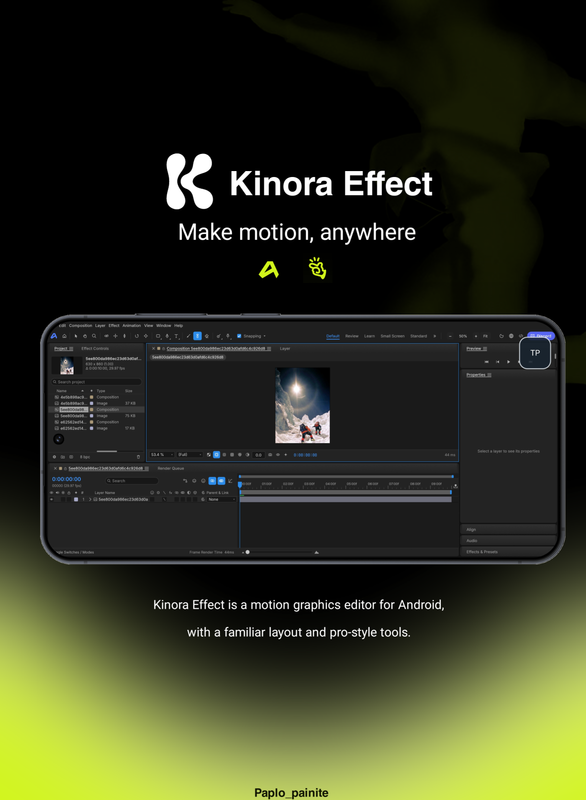

# Kinora Effect

  <a href="https://github.com/Paplo-painite/Kinora-Effect/releases/latest"><strong>Download the latest APK</strong></a>
  · <a href="docs/USER_GUIDE.md">Read the user guide</a>
  · <a href="https://github.com/Paplo-painite/Kinora-Effect/issues">Report a problem</a>

  

**Kinora Effect** is an open-source motion graphics and visual effects editor for Android, based on the EffectCraft creative application. It brings a desktop-style workspace to touch devices, with a composition viewer, timeline, dockable panels, and controls for editing projects on the go.

  

## What you can do

- Arrange and review visual work in the **Composition** viewer and **Timeline**.
- Work with project, layer, property, effect, audio, and render panels.
- Adjust the interface scale from **50% to 200%**, or use **Fit** and the **Kinora Fit** workspace on smaller screens.
- Open and save projects through Android’s system file picker.
- Use the optional reference pointer controls included in the current release, alongside normal touch input.
- Customize the workspace for landscape editing on phones and tablets.
- Receive an in-app notice when a newer public release is available.

The repository icon above is Kinora Effect’s project identity artwork. It is separate from the editor’s tool icons.

## Download and install

Get the current Android APK from the official [GitHub Releases page](https://github.com/Paplo-painite/Kinora-Effect/releases/latest). Releases include a SHA-256 checksum file when one is published.

Install only APKs from the official project release page. If Android reports a signature conflict while updating an older test build, back up your projects and remove that older build before installing the release APK.

## Quick start

1. Download and install the latest APK from [Releases](https://github.com/Paplo-painite/Kinora-Effect/releases/latest).
2. Open Kinora Effect and wait for the workspace to finish loading. Landscape orientation gives the desktop-style layout more room.
3. Create a project or open one from the application menu. Use **Composition** to preview, **Timeline** to arrange content, and the side panels to edit.
4. Save your project, then use **Render Queue** to prepare an output.

For step-by-step instructions and troubleshooting, see the [User Guide](docs/USER_GUIDE.md).

## Touch and pointer controls

Kinora Effect supports normal touchscreen interaction. The current **v0.16.3** release also includes an optional reference pointer: use **TP** in the top toolbar to access it, with separate **L** and **R** click controls and a configurable magnifier. Pointer settings include options such as sensitivity, size, opacity, and behavior. See the [release notes](https://github.com/Paplo-painite/Kinora-Effect/releases/latest) for version-specific details.

If interface controls feel small, increase **Settings > Appearance > UI Scale**, use **Fit**, or switch to the **Kinora Fit** workspace. The [User Guide](docs/USER_GUIDE.md) includes additional touch and performance tips.

## Build from source

The project includes scripts for producing Kinora-branded Android builds. Build prerequisites, setup details, and script usage are documented in the [Android Builder guide](android-builder/README.md). The repository also contains [`build.sh`](build.sh) and [`build-debug.sh`](build-debug.sh) at its root.

## Project status and support

Kinora Effect is an active project based on EffectCraft. Android devices and versions can differ, and the application continues to evolve. Keep a copy of important projects and mention your device model, Android version, Kinora Effect version, and reproducible steps when reporting an issue.

- [Report a bug](https://github.com/Paplo-painite/Kinora-Effect/issues/new?template=bug_report.md)
- [Request a feature](https://github.com/Paplo-painite/Kinora-Effect/issues/new?template=feature_request.md)
- [View all issues](https://github.com/Paplo-painite/Kinora-Effect/issues)

## Documentation

- [User Guide](docs/USER_GUIDE.md)
- [Changelog](android-builder/CHANGELOG.md)
- [Contributing](CONTRIBUTING.md)
- [Security policy](SECURITY.md)
- [Third-party notices](THIRD_PARTY_NOTICES.md)

## Licensing and credits

Kinora-specific source code and documentation are available under the MIT License. The repository also contains upstream code and dependencies that carry their own terms; see [THIRD_PARTY_NOTICES.md](THIRD_PARTY_NOTICES.md) and the accompanying license files. Kinora Effect launcher artwork is provided by the repository owner and is not covered by the general MIT grant unless stated separately.

- **Kinora Effect:** Paplo-painite
- **AI assistance:** Manus AI
- **Upstream creative application:** EffectCraft

If Kinora Effect is useful to you, consider starring the repository and sharing a clear, reproducible issue or improvement.
